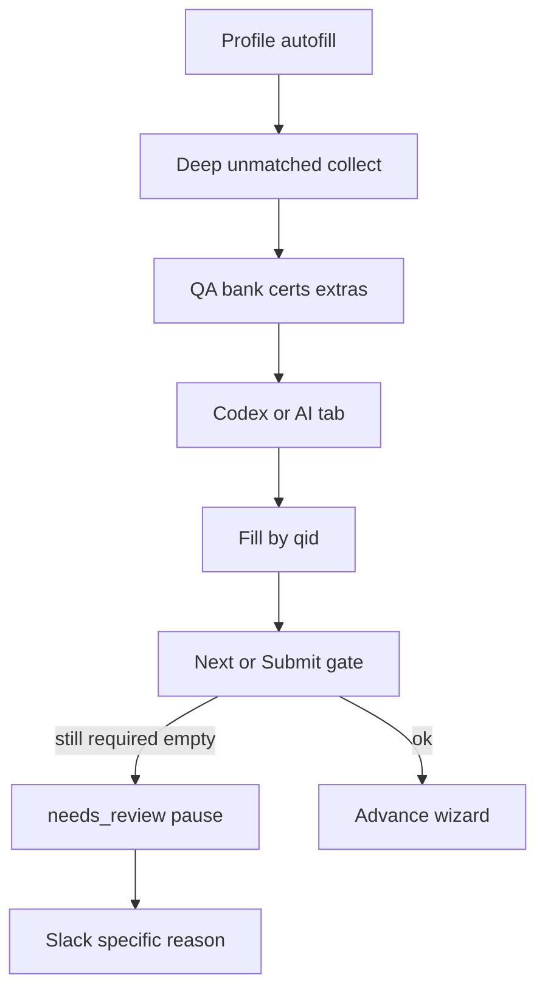

# ATS required-form Q&A recovery

Pattern pioneered on **Dice** hosted multi-step apply. Reuse the same stack when another board’s auto-apply (or panel Auto Apply) stalls on required screening / custom questions.

Parent invariants (do not weaken): [brightstar-auto-apply](../brightstar-auto-apply/SKILL.md) — especially submit-safety and “Dice may batch-submit; others panel-only unless product decision.”

## Goal

Profile fill → stamp unmatched fields → **Q&A bank** → **Codex or AI tab** → fill → Next/Submit. If still required-empty → `needs_review`, leave tab open, **Slack with specific reason**. Never invent past bank/engine for consequential/sensitive labels; never Submit with blank requireds.



## Ownership

| Concern | File / symbol |
|---------|----------------|
| Shadow-deep collect + write-back | `content/autofill.js` — `queryAllDeep`, `collectUnmatchedQuestions`, `collectUnmatchedChoiceQuestions`, `fillAiAnswers`, `fillChoiceAnswers` |
| Bank match | `qa-store.js` — `findQaMatch` (≥ 0.82) |
| Orchestration + force recovery | `autofill-runner.js` — `fillUnmatchedAnswers`, `runSecondFillPass`, `runEngineRequiredFillPass`, `ensureRequiredFieldsBeforeSubmit` |
| Engine preference | `custom_qa_engine` storage; `getStoredCustomQaEngine` / `setStoredCustomQaEngine` / `normalizeCustomQaEngine` |
| SW asker hook | `setCustomQaEngineAsker` (registered in `background.js`) |
| Codex / AI tab ask | `background.js` — `askCustomQaEngineOnce`, `askCodexWithChatGptSession`, `automateChatGpt` |
| Pause + Slack | `pauseAfterFailedHostedApply`, `isUnanswerableRequiredPause`, `trySlackAlert` |
| Popup engine radios | `popup.html` / `popup.js` — persist `custom_qa_engine` |

## Engine routing (batch default)

1. Bank / certs / profile first (always).
2. Stored Custom Q&A engine:
   - **`chatgpt`** → AI tab (`ensureAiTab` + `automateChatGpt`, ChatGPT or Claude from `ai_provider`).
   - **`codex`** or unset → **Codex** (ChatGPT account session; preferred for unattended batch so resume harvest tab is not stolen).
   - **`openai`** → OpenAI leftover helpers only (`enrichAnswersWithAi` API path).
3. Codex failure → one AI-tab fallback, then treat leftovers as unanswerable.
4. Cap batch engine asks (~8 questions per pass). Bank clean **labels** (not option-formatted prompts).

`forceAi: true` on recovery passes so assist toggle does not skip engine asks.

## Porting to another job site

Do **not** fork a parallel Q&A stack. Extend this one:

1. **Adapter policy** — `ats/adapters.js`: only raise `autoSubmitAllowed` / wire batch interleaved apply after an explicit product decision (today Dice-only for batch submit).
2. **DOM** — Prefer generic `queryAllDeep` collectors. Add a site-specific collector (like Workday `formField` / Lever cards) only when labels/options are unreliable; stamp the same `data-resume-bot-qid` / `data-resume-bot-choice-qid`.
3. **Fill write-back** — Always resolve stamps with `queryAllDeep` (light DOM `querySelector` misses web components).
4. **Wire recovery** — Call `ensureRequiredFieldsBeforeSubmit` (or `runEngineRequiredFillPass`) before Submit **and** when Next cannot advance due to validation. Set `summary.pauseKind = "unanswerable_required"` + `unansweredLabels`.
5. **Batch pause** — Hosted apply path should pass `pauseKind` / labels into `pauseAfterFailedHostedApply` so Slack fires with field-level detail.
6. **Bump** `AUTOFILL_SCRIPT_BUILD` when `content/autofill.js` changes so frames re-inject.
7. **Tests** — Engine normalize / adapters / site smoke; `npm run check` + `npm test`.
8. **Manifest** — New hosts need `content/autofill.js` matches.

### Site-specific checklist

```
- [ ] Collector sees required fields (deep or dedicated)
- [ ] Choice fields expose options (open menus if needed)
- [ ] Bank hit works for common screening Qs
- [ ] Codex/AI-tab recovery runs when bank misses
- [ ] Submit gated until validation clear
- [ ] Unanswerable → pause + Slack lists labels
- [ ] Submit-safety still uses resolveEffectiveAutoSubmit
```

## Pause / Slack contract

- **Unanswerable required** (`pauseKind === "unanswerable_required"` or required-validation detail): Slack title like `Dice apply paused — required field unanswered` (adapt board name), message = validation reason + unanswered labels (truncated), plus csv row / company / title / person.
- **CAPTCHA / sign-in**: pause with tab open; do **not** use the unanswerable-required Slack title (existing job-status ping is enough).
- Slack webhook missing → no-op; never fail the batch on notify errors.

## Anti-patterns

- Collecting unmatched fields with light-DOM-only `querySelectorAll` on web-component ATS pages.
- Calling OpenAI leftovers for batch recovery when the product expects Codex / AI tab.
- Auto-submitting with empty requireds or inventing answers for sensitive/consequential fields.
- Enabling batch auto-submit for a new ATS without an explicit product decision (invariant #3 in parent skill).
- Duplicating Custom Q&A prompt/session logic instead of `prepareCustomQaAsk` + asker hook.

## Verify

```bash
npm run check
npm test
```

Smoke: target ATS wizard step with a required select/radio in shadow or custom card → bank or Codex/AI-tab fill → advance; force an unanswerable required → batch pause + Slack shows the field reason. Reload unpacked extension after code changes.
